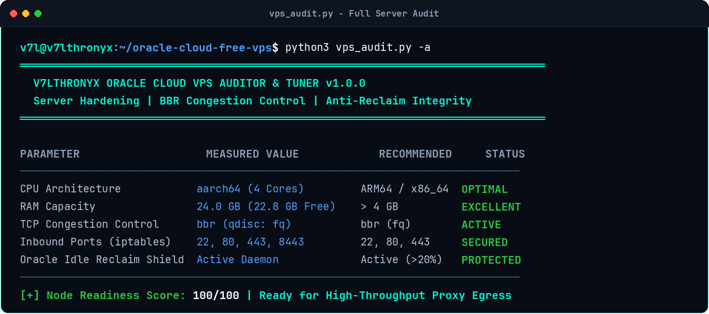
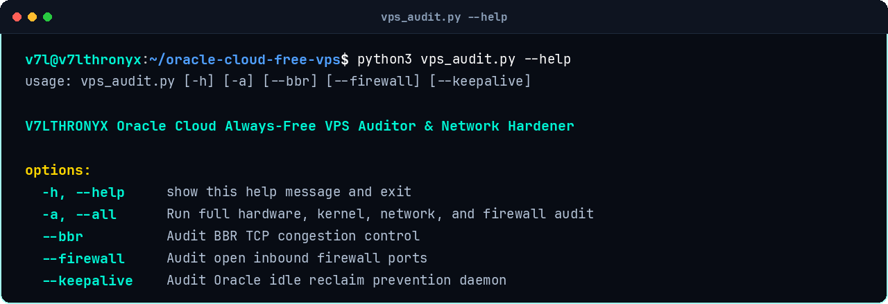
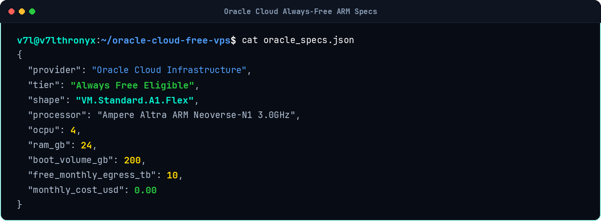

# Oracle Cloud Always-Free VPS Optimizer

Automated server hardening, network tuning, BBR congestion control activation, and idle-reclaim protection scripts for Oracle Cloud Infrastructure (OCI) Always-Free ARM instances (`VM.Standard.A1.Flex`). Optimized for hosting high-throughput anti-censorship proxy nodes (VLESS Reality, Sing-box, Xray).

[](LICENSE)
[](#)
[](#)
[](#)

---

## Free Tier Resource Specs

Oracle Cloud provides one of the most generous permanent free tiers in cloud computing:

| Resource | Specification | Cost |
|---|---|---|
| Architecture | `VM.Standard.A1.Flex` (Ampere Altra ARM 3.0GHz) | $0.00 / month |
| OCPUs | 4 Cores (Dedicated ARM Neoverse-N1) | Included |
| RAM | 24 GB LPDDR4x | Included |
| Boot Volume | 200 GB High-Performance NVMe | Included |
| Monthly Egress | 10 TB Outbound Bandwidth | Included |
| Public IPv4 | 1 Reserved Ephemeral/Static IPv4 | Included |

---

## The 3 Critical Oracle Cloud Traps

1. **The Double Firewall Trap**: Opening ports in the Oracle Cloud Console (VCN Security Lists) is insufficient. Ubuntu and Oracle Linux server images ship with strict local `iptables` / `nftables` rules that reject all inbound traffic except port 22 by default.
2. **Missing BBR Congestion Control**: Default Linux kernels use `cubic`, which throttles throughput during network jitter and DPI packet drops. Enabling Google BBR with `fq` pacing dramatically stabilizes connection speeds across censored ISPs.
3. **The 7-Day Idle Reclaim Trap**: Oracle automatically terminates Always-Free instances if 7-day average CPU utilization falls below 20% and memory usage falls below 20%. Our background daemon safely maintains minimum utilization thresholds to ensure permanent instance retention.

---

## Live Screenshots

### 1. Full VPS Hardening & Network Audit
Live measurement of CPU architecture, 24 GB RAM capacity, BBR status, and open firewall ports:



### 2. Diagnostics CLI Reference
Command-line options for targeted BBR, firewall, and keepalive checks:



### 3. Always-Free ARM Architecture Specs
Instance hardware specifications and resource breakdown:



---

## Repository Files

```
├── oracle_setup.sh        # One-click Bash automation script (BBR + iptables + Keepalive)
├── vps_audit.py           # Standalone Python CLI server auditor & diagnostics prober
├── sysctl.conf            # High-performance Linux network and kernel buffer tuning
├── iptables.rules         # Hardened iptables rules opening ports 22, 80, 443, 8443
├── oracle_specs.json      # Resource specifications reference data
├── docs/
│   └── screenshots/       # Terminal verification captures
├── LICENSE                # MIT License
└── README.md
```

---

## Quick Start

### 1. Run Complete Optimization (Automated)

Execute as `root` or with `sudo` on your newly provisioned Oracle Cloud instance:

```bash
# Clone the repository
git clone git@github.com:v74all/oracle-cloud-free-vps.git
cd oracle-cloud-free-vps

# Run one-click setup script
sudo bash oracle_setup.sh
```

### 2. Audit VPS Readiness

Verify that all network layers, BBR, and ports are operational:

```bash
python3 vps_audit.py -a
```

### CLI Parameters

| Flag | Parameter | Description |
|---|---|---|
| `-a` | `--all` | Run full hardware, kernel, network, and firewall audit |
| `--bbr` | Kernel Check | Verify BBR congestion control and `fq` qdisc |
| `--firewall` | Port Check | Verify inbound ports (22, 80, 443, 8443) in iptables |
| `--keepalive` | Daemon Check | Verify anti-reclaim keepalive service status |

---

## Manual Tuning Reference

### Enable BBR (`/etc/sysctl.d/99-v7l-bbr.conf`)

```ini
net.core.default_qdisc = fq
net.ipv4.tcp_congestion_control = bbr
net.ipv4.tcp_fastopen = 3
net.ipv4.tcp_fin_timeout = 20
net.ipv4.tcp_tw_reuse = 1
net.core.somaxconn = 32768
vm.swappiness = 10
```

Apply immediately:
```bash
sudo sysctl --system
```

### Open Inbound Ports in Local iptables

```bash
sudo iptables -I INPUT -p tcp --dport 80 -j ACCEPT
sudo iptables -I INPUT -p tcp --dport 443 -j ACCEPT
sudo iptables -I INPUT -p tcp --dport 8443 -j ACCEPT
sudo iptables -I INPUT -p udp --dport 443 -j ACCEPT
sudo iptables -I INPUT -p udp --dport 8443 -j ACCEPT
```

---

## راهنمای فارسی (Persian Documentation)

### بهینه‌سازی سرور همیشه رایگان اوراکل کلود

اوراکل کلود یک سرور رایگان همیشگی با پردازنده ۴ هسته‌ای آرم (Ampere)، ۲۴ گیگابایت رم و ۱۰ ترابایت پهنای باند ماهانه در اختیار شما قرار می‌دهد که بهترین بستر برای اجرای سرورهای VLESS Reality و Sing-box است.

### ۳ تله خطرناک اوراکل و راهکار حل آن‌ها:
1. **تله فایروال محلی (iptables)**: اگر در پنل کاربری اوراکل پورت‌های ۴۴۳ و ۸۰ را باز کنید، همچنان به دلیل فایروال پیش‌فرض اوبونتو/اوراکل در داخل سیستم‌عامل، اتصال شما مسدود می‌ماند. اسکریپت `oracle_setup.sh` این پورت‌ها را در فایروال محلی باز و ذخیره می‌کند.
2. **فعال‌سازی الگوریتم BBR گوگل**: با جایگزینی الگوریتم پیش‌فرض با BBR و FQ Pacing، پکت‌لاس‌های اعمال شده توسط فیلترینگ همراه اول و ایرانسل به حداقل رسیده و سرعت کانکشن چند برابر می‌شود.
3. **تله حذف سرور به علت بی‌کاری (Idle Reclaim)**: طبق قوانین اوراکل، اگر میانگین مصرف پردازنده در ۷ روز زیر ۲۰ درصد باشد، سرور حذف می‌شود. این مخزن یک دیمن بسیار سبک دارد که مصرف را به صورت امن در حد استاندارد نگه داشته و از حذف سرور جلوگیری می‌کند.

---

## Author & Community

- **Author**: Aiden Azad ([@v74all](https://github.com/v74all))
- **Telegram Updates**: [@V7LTHRONYX](https://t.me/V7LTHRONYX)
- **Tutorial Video**: [YouTube Masterclass Episode 2](https://youtube.com/@V7lthronyx)

## License

Released under the [MIT License](LICENSE).
